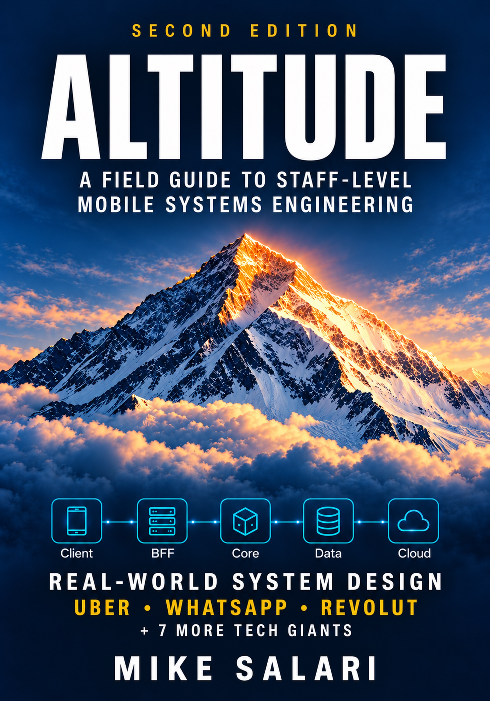

# Staff mobile engineer is not senior plus

**What the staff job changes, week by week, and what to start doing before anyone gives you the title.**

Free sample of *Altitude* by **Mike Salari** · [salari.dev](https://salari.dev)

[**Read on desktop**](Altitude-sample-desktop.pdf) · [**Read on your phone**](Altitude-sample-mobile.pdf) · [**Get the full book**](https://mikesalari.gumroad.com/l/altitude?utm_source=github&utm_medium=sample&utm_campaign=altitude_staff_sample)

---

## The best senior on the team gets promoted. Six months later they are the most tired person in the room.

Someone tells them to keep doing what they do, just more of it. So they take more tickets, answer more Slack threads and review more pull requests. The backlog is no shorter, and the promotion feels more like a fine than a reward.

Nothing is wrong with the engineer. They are using the habits that made them a strong senior in a job that needs different ones. This sample shows what the job needs instead.

## What's inside

- **A week in the staff job.** Monday to Friday: assessments, the engineering manager, the other staff engineers, the incident, the client. Each day ends with what a senior can take from it.
- **What the job posts ask for.** Fox, Uber and Square name the same core work. Five staff mobile postings are quoted in the notes with company, title, link and date.
- **Four habits that separate senior plus from staff.** SwiftUI versus UIKit, a new SDK, ANRs on Android, changing requirements.
- **What Altitude teaches.** Mobile system design at staff level: priced trade-offs, failure timelines, one method used throughout.
- **One section from chapter 22, word for word.** Refresh token rotation, reuse detection and the train problem, with the book's figure.
- **A Companion worksheet.** Worksheet 22, set the token lifecycle for a messaging app, with two lines from its review notes.
- **What the full book covers.** Parts, chapters, case studies, interview questions and the Engineering Companion.

## Pick your screen

| Edition | Best for | Pages | Open |
| --- | --- | ---: | --- |
| **Desktop** | Laptop, large screen, print | 15 | [Desktop PDF](Altitude-sample-desktop.pdf) |
| **Mobile** | Reading on a phone, no zooming | 20 | [Mobile PDF](Altitude-sample-mobile.pdf) |

Same content, two layouts. Free, no email, no sign-up.

## The full book

*Altitude: A field guide to staff-level mobile systems engineering*, second edition, version 2.1. Chapters on system design, API and BFF design, auth, security, observability, offline sync, distributed systems and the cloud, then the staff role itself.

| Edition | What you get |
| --- | --- |
| **Book** | PDF and EPUB. 556 pages, 30 chapters in 5 parts, 3 case studies (ride-hailing, global messaging, high-assurance financial). Every chapter has interview questions and warm-up, build and stretch exercises |
| **Engineering Companion** | 4 PDF volumes, 410 pages: 30 worksheets, 6 game days, an interview bank for every chapter, 16 templates, 5 filled examples, 6 checklists and 3 capstones |

**[Get it on Gumroad](https://mikesalari.gumroad.com/l/altitude?utm_source=github&utm_medium=sample&utm_campaign=altitude_staff_sample)** · [salari.dev/books/altitude](https://salari.dev/books/altitude)

## Who it's for

Senior mobile engineers aiming at staff, new staff engineers, and mobile architects. iOS and Android alike. You should already be comfortable shipping production apps and reading other people's designs.

## About the author

**Mike Salari** is a Staff mobile engineer. 15+ years across Apple, Adobe, Cisco, Visa, Mastercard and Deloitte, and 500+ technical interviews from the hiring side. He writes about software engineering and careers at [salari.dev](https://salari.dev).

[Website](https://salari.dev) · [LinkedIn](https://www.linkedin.com/in/mike-salari/)

## Sharing and copyright

© 2026 Mike Salari. All rights reserved.

Share the link to this repository freely. The PDFs are free to read for personal use. They are not licensed for redistribution, adaptation or commercial use. For anything beyond reading, ask the author first.
